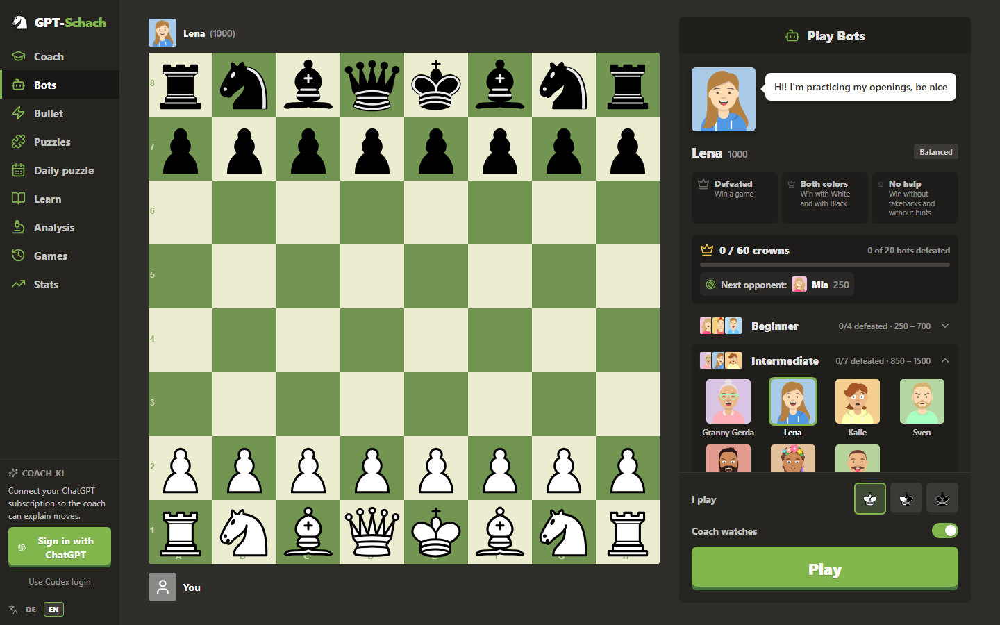
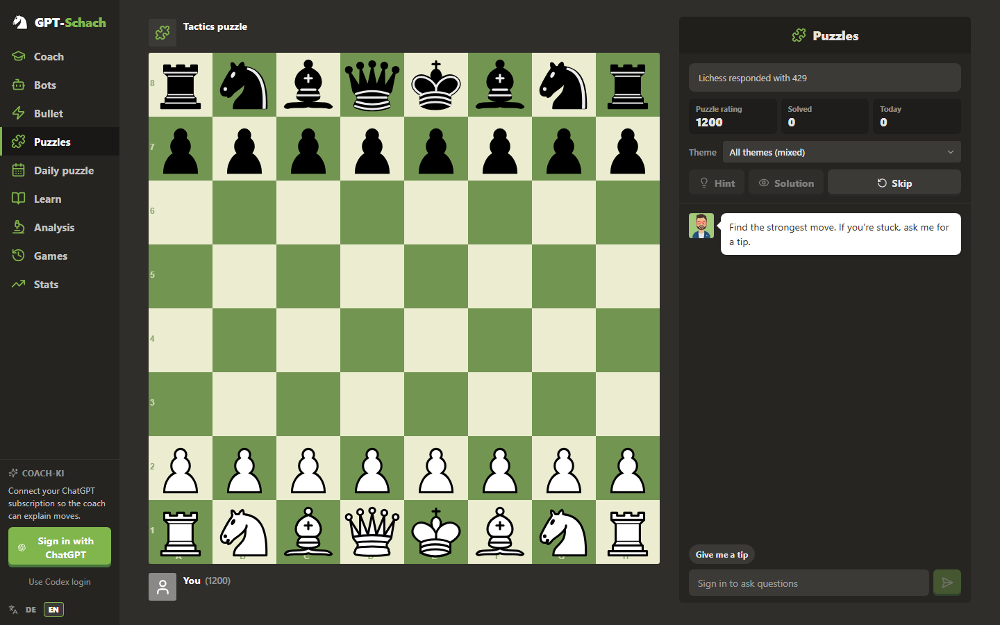
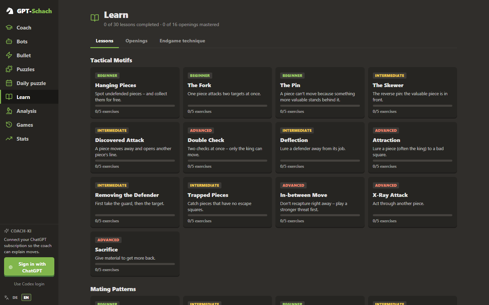
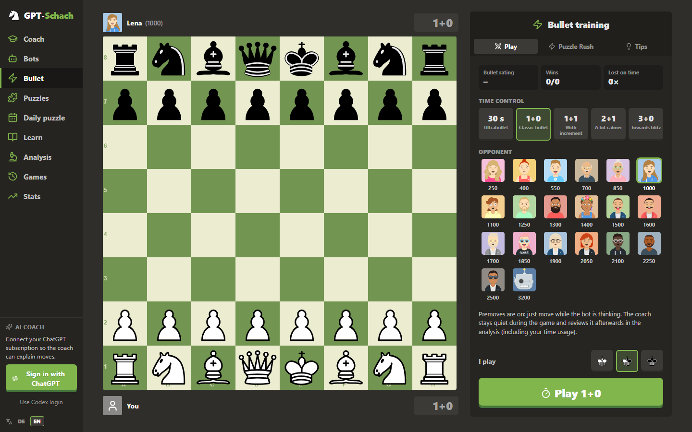

# ♞ GPT-Schach

**Chess training with an AI coach – running locally on your machine, powered by your own ChatGPT subscription.**
Bots with personalities, a coach that explains every move, unlimited tactics puzzles, lessons, an opening trainer, game review, bullet training and stats – no extra subscription, no chess-site account.

The app is available in **English and German** (switch at the bottom left).



---

## Features

| Area | What you get |
|---|---|
| **Coach** | Plays at your level, rates every move (best move … blunder), explains ideas in plain words, hints in 3 steps, take back/redo, clickable variations |
| **Bots** | 20 bots from 250 to 3200 with their own playing styles (attacker, trader, copycat, gambiteer …) and **crowns** to earn. Pick an **opening** the bot should play – or just ask the coach ("play the Caro-Kann against me") |
| **Explore** | In the middle of a game, move both sides freely and watch Stockfish evaluate the position live |
| **Bullet** | Games with a clock (30 s – 3+0) and premoves, **Puzzle Rush**, review of your thinking time |
| **Puzzles** | Unlimited tactics puzzles from the open Lichess database, daily puzzle, your own puzzle rating, theme filter |
| **Learn** | 30 lessons (tactics, mating patterns, attack, endgames), 26 openings to practice, endgame technique against Stockfish |
| **Analysis** | Every game is saved: accuracy, mistakes, evaluation graph, time usage, review by the coach; free analysis board with FEN/PGN |
| **Stats** | Rating, puzzle rating, bullet rating, win rate then vs. now, strengths and weaknesses |

The chess engine (Stockfish 17.1) runs right in your browser. The coach uses your ChatGPT account – without signing in, everything works except the written explanations.

## Screenshots

| Puzzles | Learn | Bullet |
|---|---|---|
|  |  |  |

## Installation

You need **[Node.js](https://nodejs.org) 20 or newer** (just install the LTS version) and **[Git](https://git-scm.com)** – or download the repo as a ZIP (green "Code" button → "Download ZIP") and unpack it.

```bash
git clone https://github.com/Dolcruz/gpt-schach.git
cd gpt-schach
npm install
npm start
```

Your browser opens automatically at **http://gpt-schach.localhost:8080**. On first start the app is built once (a few seconds). Stop it with `Ctrl + C`.

### Windows: desktop icon

```bash
npm run shortcut
```

Creates "GPT-Schach" on your desktop and in the Start menu. A double-click starts everything invisibly in the background and opens **http://gpt-schach.localhost**. To stop it, double-click `stop.vbs` in the folder.

### Updating

```bash
git pull
npm install
```

The app is rebuilt automatically on the next start. Your games and progress are kept.

## Sign in with ChatGPT

Click **"Sign in with ChatGPT"** at the bottom left and log in with your ChatGPT account in the popup (same login as the Codex CLI). Then pick the coach model and the reasoning effort.

- Requires a ChatGPT plan that includes Codex (e.g. Plus or Pro).
- If you already use the **Codex CLI or the Codex app**, a click on **"Use Codex login"** is enough.
- The login briefly uses port `1455` on your machine (like Codex) – don't run it at the same time as a Codex login.

## Where is my data?

Everything stays on your machine in the `data/` folder:
- `data/auth.json` – your login tokens (only ever sent to OpenAI)
- `data/store.json` – games, puzzles, learning progress

The server only listens on `localhost` and can't be reached from other devices.

## FAQ

**The page doesn't open?** `*.localhost` addresses work automatically in Chrome, Edge and Firefox. Alternatively open `http://localhost:8080`.

**Port in use?** Choose another port: `PORT=9000 npm start` (Windows PowerShell: `$env:PORT=9000; npm start`).

**The model list is empty?** The available models depend on the reported Codex version: `CODEX_CLIENT_VERSION=<current Codex version> npm start`.

**How strong is the engine?** Stockfish 17.1 (WASM). The coach searches at depth 18, game review at depth 16, live analysis up to depth 24 – reliable for players well above 2000 Elo.

## Development

```bash
npm run dev      # server on :3001 + Vite on :5173 with hot reload
npm run build    # type check + production build into dist/
```

Structure: `src/` (React frontend), `server/` (login, coach proxy, data store, puzzle proxy), `public/engine/` (Stockfish). Texts live inline as `L('Deutsch', 'English')` (see `src/i18n.ts`).

## Notes

- **Unofficial hobby project.** Not affiliated with OpenAI, Lichess or chess.com. Signing in uses the same route as the official Codex CLI; OpenAI may change it at any time. Use at your own risk and within the terms of your ChatGPT plan.
- Puzzles come from the [Lichess puzzle database](https://database.lichess.org/#puzzles) (CC0) and are loaded via the public Lichess API.

## License & credits

GPT-Schach is licensed under the **GNU GPL v3** (see [LICENSE](LICENSE)).

- [Stockfish](https://stockfishchess.org) & [stockfish.js](https://github.com/nmrugg/stockfish.js) – GPL-3.0
- [chessground](https://github.com/lichess-org/chessground) (board & cburnett pieces) – GPL-3.0
- [chess.js](https://github.com/jhlywa/chess.js) – BSD-2-Clause
- [DiceBear](https://www.dicebear.com) (avatars, styles "Avataaars" and "Bottts" by Pablo Stanley) – see their licenses
- [Lucide](https://lucide.dev) icons – ISC
- Puzzles: [Lichess](https://lichess.org) – CC0

---

## 🇩🇪 Kurz auf Deutsch

Lokale Schach-App mit KI-Coach über dein eigenes ChatGPT-Abo: Bots mit Kronen, Puzzles, Lektionen, Eröffnungstrainer, Analyse, Bullet und Statistik. Die App ist komplett auf Deutsch und Englisch verfügbar (Umschalter links unten).

**Installation:** Node.js ab Version 20 installieren, dann `git clone https://github.com/Dolcruz/gpt-schach.git`, `cd gpt-schach`, `npm install`, `npm start`. Unter Windows legt `npm run shortcut` ein Desktop-Symbol an. Links unten mit ChatGPT anmelden – fertig. Alle Daten bleiben lokal im Ordner `data/`.
